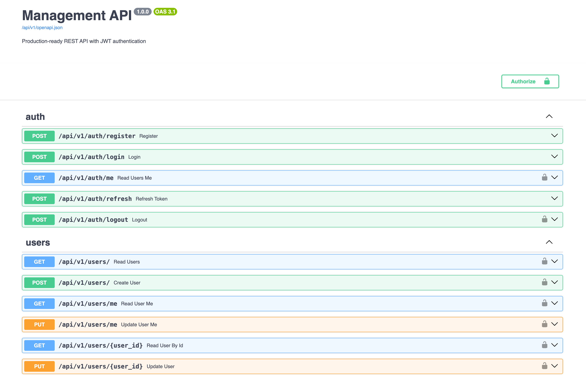
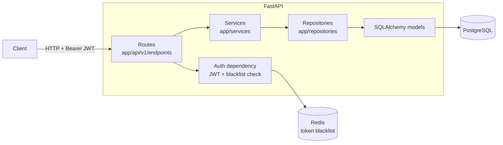

# FastAPI Management API — Async REST API with JWT Auth, PostgreSQL & Redis

[](https://github.com/MedinDev/fastapi-management-api/actions/workflows/ci.yml)
[](https://www.python.org/)
[](https://fastapi.tiangolo.com/)
[](LICENSE)

An async REST API for managing users, products and tasks, built with FastAPI, SQLAlchemy 2.0 (async), PostgreSQL and Redis. It implements JWT authentication with access and refresh tokens, server-side logout via a Redis token blacklist, role-based authorization, a layered routes → services → repositories architecture, and Alembic migrations. Everything runs with one `docker compose up`.



## Features

- **JWT authentication** — short-lived access tokens (30 min) and refresh tokens (7 days), HS256
- **Real logout** — revoked tokens are stored in Redis until they expire, and every request checks them; if Redis is down, requests are rejected rather than trusted
- **Argon2 password hashing** via passlib
- **Role-based access** — `admin`, `manager` and `user` roles; admins see everything, other users only see resources they own or are assigned to
- **CRUD** for users, products and tasks, with pagination (`skip` / `limit`)
- **Dashboard endpoint** with per-user or global counts
- **Async throughout** — asyncpg driver and SQLAlchemy 2.0 async sessions
- **Migrations** with Alembic, and a seed script for sample data
- **Interactive docs** — Swagger UI and ReDoc generated from the Pydantic schemas

## Architecture



| Layer | Responsibility |
| --- | --- |
| `api/v1/endpoints` | HTTP routing, request validation, authorization checks |
| `api/deps.py` | Current-user dependency: verifies the JWT and rejects revoked tokens |
| `services` | Business logic (registration, authentication) |
| `repositories` | Database access behind a generic async CRUD base class |
| `models` / `schemas` | SQLAlchemy tables and Pydantic request/response models |

## Quick start

Requirements: Docker with Compose.

```bash
git clone https://github.com/MedinDev/fastapi-management-api.git
cd fastapi-management-api
cp .env.example .env

docker compose up -d
docker compose exec api alembic upgrade head
docker compose exec api python scripts/seed_data.py
```

| Service | URL |
| --- | --- |
| Swagger UI | http://localhost:8000/docs |
| ReDoc | http://localhost:8000/redoc |
| Health check | http://localhost:8000/health |
| pgAdmin | http://localhost:5050 |

## API

All routes are under `/api/v1`. Everything except register, login and refresh requires `Authorization: Bearer <access_token>`.

| Method | Path | Description |
| --- | --- | --- |
| `POST` | `/auth/register` | Create an account |
| `POST` | `/auth/login` | Get access + refresh tokens |
| `POST` | `/auth/refresh` | Exchange a refresh token for new tokens |
| `POST` | `/auth/logout` | Revoke the current access token |
| `GET` | `/auth/me` | Current user |
| `GET` `POST` | `/users/` | List / create users |
| `GET` `PUT` | `/users/me` | Read / update own profile |
| `GET` `PUT` | `/users/{id}` | Read / update a user |
| `GET` `POST` | `/products/` | List / create products |
| `GET` `PUT` `DELETE` | `/products/{id}` | Read / update / delete a product |
| `GET` `POST` | `/tasks/` | List / create tasks |
| `GET` `PUT` `DELETE` | `/tasks/{id}` | Read / update / delete a task |
| `GET` | `/dashboard/stats` | Product and task counts |

Example:

```bash
curl -X POST localhost:8000/api/v1/auth/register \
  -H "Content-Type: application/json" \
  -d '{"email":"ada@example.com","username":"ada","password":"s3cure-pass","full_name":"Ada Lovelace"}'

TOKEN=$(curl -s -X POST localhost:8000/api/v1/auth/login \
  -d "username=ada@example.com&password=s3cure-pass" | jq -r .access_token)

curl localhost:8000/api/v1/auth/me -H "Authorization: Bearer $TOKEN"
```

## Testing

Tests run against a real PostgreSQL database (`test_db`) and Redis, the same way CI does.

```bash
docker compose up -d postgres redis
docker compose exec postgres createdb -U postgres test_db
poetry install
poetry run pytest
```

Set `TEST_DATABASE_URL` to point the tests at a different database. CI starts Postgres and Redis as service containers and runs the suite with coverage on every push.

## Design decisions

- **Repository pattern.** Routes never build queries directly. A generic `BaseRepository` provides async CRUD, and specific repositories add queries like "products owned by user". That keeps the routes thin and the data access testable.
- **Stateless JWTs plus a blacklist.** JWTs avoid a session lookup on every request, but they can't be revoked on their own. Storing only *revoked* tokens in Redis, with a TTL equal to the token lifetime, gives real logout while keeping the store small.
- **Fail closed on auth.** If Redis is unreachable, the API returns `503` instead of accepting tokens it can't verify.
- **Argon2 over bcrypt.** Argon2 is memory-hard, which makes GPU brute-forcing more expensive, and it won the Password Hashing Competition.
- **Integration tests on real Postgres.** Running tests against SQLite would hide Postgres-specific behavior (enums, constraints, async driver quirks).

## Tech stack

FastAPI · Pydantic v2 · SQLAlchemy 2.0 (async) · asyncpg · PostgreSQL 15 · Redis 7 · Alembic · python-jose · passlib (Argon2) · pytest + httpx · Docker Compose · GitHub Actions

## Roadmap

- [ ] Rate limiting on login and registration (Redis sliding window)
- [ ] Prometheus `/metrics` endpoint and structured request logging
- [ ] Audit log writes for create/update/delete (model exists)
- [ ] Unit tests for services and product/task endpoints
- [ ] Production Dockerfile and Nginx reverse proxy
- [ ] Load test results

## License

[MIT](LICENSE)
