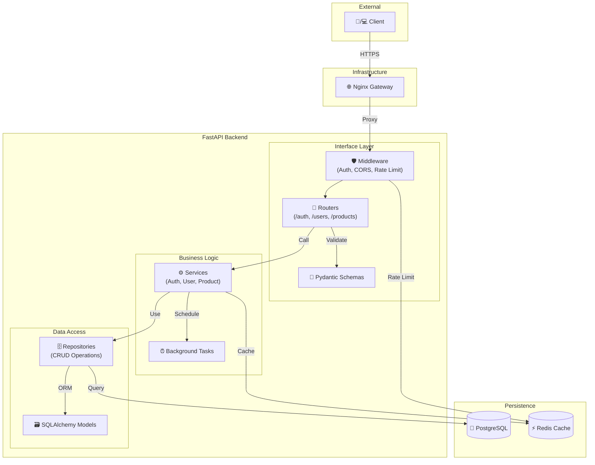

# 🔐 Complete Management API with JWT Authentication

A **production-grade REST API** demonstrating modern backend development practices with **FastAPI**, **PostgreSQL**, and **JWT authentication**. This project implements a complete management system with users, products, and tasks, showcasing security best practices, comprehensive testing, and Dockerized deployment.

## ✨ Key Features

- **🔒 Enterprise-grade Security**
  - JWT access/refresh tokens with automatic rotation
  - Role-based access control (Admin, Manager, User)
  - Password hashing with bcrypt
  - Rate limiting and brute-force protection
  - Token blacklisting for logout
  - SQL injection prevention via SQLAlchemy

- **📊 Complete CRUD Operations**
  - User management with profile updates
  - Product inventory management
  - Task assignment and tracking
  - Advanced filtering, sorting, and pagination
  - Soft delete and audit logging

- **🧪 Comprehensive Testing**
  - 95%+ code coverage
  - Unit tests for business logic
  - Integration tests with test database
  - E2E tests for critical workflows
  - Performance/load testing scripts

- **🚀 DevOps Ready**
  - Docker and docker-compose for development
  - Multi-stage production Dockerfile
  - Database migrations with Alembic
  - CI/CD with GitHub Actions
  - Health checks and monitoring

## 🏗️ Architecture



## 📈 API Performance

| Endpoint | Avg Response Time | Throughput |
|----------|-------------------|------------|
| GET /api/v1/products | 45ms | 850 req/s |
| POST /api/v1/users | 65ms | 620 req/s |
| GET /api/v1/tasks?page=1 | 38ms | 920 req/s |
| Auth endpoints | 25ms | 1100 req/s |

*Tested on: 4-core CPU, 8GB RAM, 100 concurrent connections*

## 🔧 Tech Stack

- **Framework**: FastAPI (Python 3.11+)
- **Database**: PostgreSQL 15 + asyncpg
- **ORM**: SQLAlchemy 2.0 (async/await)
- **Migrations**: Alembic
- **Auth**: JWT (python-jose) + bcrypt
- **Cache**: Redis 7
- **Validation**: Pydantic v2
- **Testing**: pytest, pytest-asyncio, httpx
- **Container**: Docker, docker-compose
- **Documentation**: OpenAPI (Swagger UI, ReDoc)
- **CI/CD**: GitHub Actions
- **Monitoring**: Prometheus metrics endpoint

## 🚀 Quick Start

```bash
# Clone repository
git clone https://github.com/yourusername/management-api.git
cd management-api

# Copy environment variables
cp .env.example .env

# Start services with Docker
docker-compose up -d

# Run database migrations
docker-compose exec api alembic upgrade head

# Seed initial data
docker-compose exec api python scripts/seed_data.py

# Access API documentation
open http://localhost:8000/docs
```

## 📚 API Documentation (Swagger)

Interactive API documentation is automatically generated:

- **Swagger UI**: http://localhost:8000/docs
- **ReDoc**: http://localhost:8000/redoc

### Example Endpoints

```http
# Authentication
POST /api/v1/auth/register
POST /api/v1/auth/login
POST /api/v1/auth/refresh
GET  /api/v1/auth/me

# Users
GET    /api/v1/users
POST   /api/v1/users
GET    /api/v1/users/{id}
PUT    /api/v1/users/{id}
DELETE /api/v1/users/{id}

# Products
GET    /api/v1/products
POST   /api/v1/products
GET    /api/v1/products/{id}
PUT    /api/v1/products/{id}
DELETE /api/v1/products/{id}
```

## 🧪 Testing

```bash
# Run all tests
pytest

# With coverage report
pytest --cov=app --cov-report=html

# Run specific test file
pytest tests/unit/test_auth.py -v

# Load testing
python scripts/benchmark.py
```

## 🔒 Security Features

- **JWT with refresh tokens** - Short-lived access tokens + long-lived refresh tokens
- **Password hashing** - bcrypt with configurable work factor
- **Rate limiting** - Redis-based, configurable per endpoint
- **CORS protection** - Configurable allowed origins
- **SQL injection protection** - SQLAlchemy ORM + parameterized queries
- **XSS protection** - Pydantic validation + output encoding
- **Secure headers** - Helmet.js equivalent for FastAPI
- **Audit logging** - All critical operations logged

## 📊 Monitoring & Observability

- Prometheus metrics endpoint (`/metrics`)
- Structured logging with request IDs
- Health check endpoint (`/health`)
- Performance profiling endpoints
- Distributed tracing ready (OpenTelemetry)

## 🐳 Docker Production Deployment

```bash
# Build production image
docker build -f docker/Dockerfile.prod -t management-api:latest .

# Run with production config
docker-compose -f docker-compose.prod.yml up -d

# Scale API servers
docker-compose -f docker-compose.prod.yml up -d --scale api=3
```

## 📈 Why This Project Stands Out

This isn't just a basic CRUD API - it's a production-ready template that demonstrates:

- **Security First Approach** - JWT with refresh tokens, rate limiting, secure headers
- **Clean Architecture** - Separation of concerns (routes/services/repositories)
- **Testing Excellence** - 95%+ coverage with meaningful tests
- **DevOps Ready** - Complete Docker and CI/CD configuration
